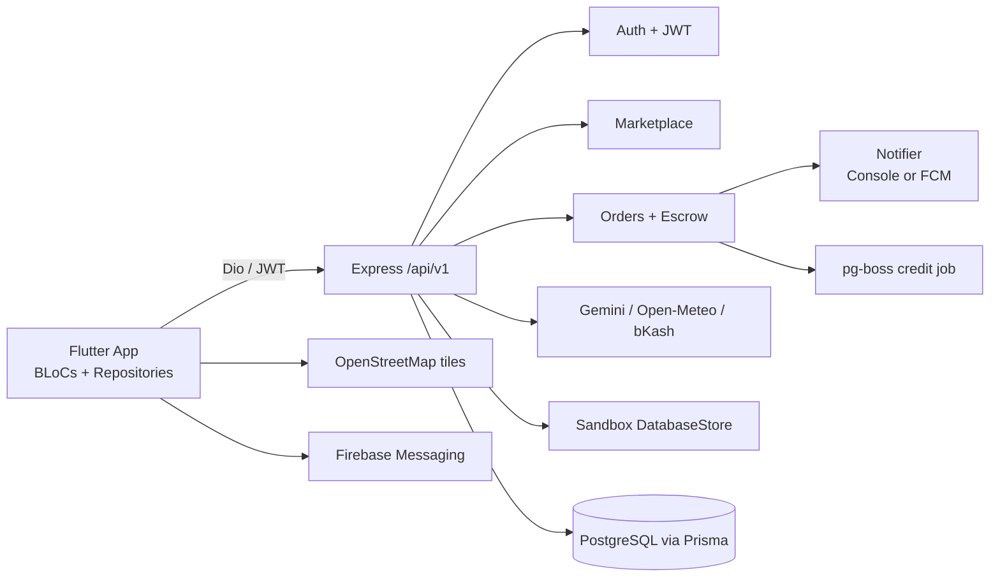

# Architecture Index

This index is not the full contract. Do not implement from this file alone; follow the artifact paths below.

## System View

## Global Artifacts

- `unit_graph.yaml`: all runtime units, source anchors, public signatures, dependencies, and shared references. Filter by assigned `name`.
- `wire_contracts.yaml`: HTTP, SQL, SDK, and frontend API contracts. Filter by `unit`; preserve frozen rows.
- `shared_modules.yaml`: cross-unit fields and handling strategy. Filter `used_by_units`; use only declared `fields`.
- `cross_unit_state.yaml`: JWT, queue, and job state flows. Filter writer/reader unit; runtime-check rows marked `must_confirm: runtime`.
- `project-structure.md`: layers, entrypoints, and domains.
- `tech-stack.md`: existing frameworks, versions, dependencies, and runtime constraints.
- `data-model.md`: entity relationships and transaction evidence.

## Implementation Guide

### Unit: auth

- External trigger: `/api/v1/auth/*` routes.
- Read `units/auth/behavior.yaml` for validation and token side effects.
- Read `units/auth/bindings.yaml` for route and JWT wiring.
- Read `units/auth/unit_decomposition.yaml` for advisory split candidates only.
- Filter global rows where `unit: auth`, `used_by_units` contains `auth`, or state writer/reader is `auth`.
- Before DONE report artifacts read, preserved token/error contracts, deferred items, and tests.

### Unit: marketplace

- External trigger: crop listing, crop lookup, bidding, and bid acceptance routes.
- Read `units/marketplace/{behavior,bindings,unit_decomposition}.yaml`.
- Filter `wire_contracts.yaml` for `unit: marketplace`; shared rows for `marketplace`; state flows touching marketplace.
- Preserve accepted-bid order/escrow creation and notification side effects.

### Unit: orders-escrow

- External trigger: order and escrow routes.
- Read `units/orders-escrow/{behavior,bindings,unit_decomposition}.yaml`.
- Filter wire, shared, and cross-state rows for `orders-escrow`; pay attention to escrow transaction boundaries and provider contract.
- Preserve state validation, ledger writes, notifications, dispute audit behavior, and error statuses.

### Unit: traceability-weather-prices

- External trigger: QR traceability, weather, and price routes/pages.
- Read `units/traceability-weather-prices/{behavior,bindings,unit_decomposition}.yaml`.
- Filter wire rows for this unit and external SDK rows for Open-Meteo/QRCode/CSV.
- Preserve public response keys, caching, spray interval warnings, and provider fallback.

### Unit: ai

- External trigger: AI assistant and image-grade routes/pages.
- Read `units/ai/{behavior,bindings,unit_decomposition}.yaml`.
- Filter Gemini wire/config rows and JWT/rate-limit state rows.
- Preserve advisory-only output, strict grade JSON, cache, and quota behavior.

### Unit: agent-group

- External trigger: agent farmer/lot routes and group payout service.
- Read `units/agent-group/{behavior,bindings,unit_decomposition}.yaml`.
- Filter agent route contracts and store/group payout rows.
- Preserve consent enforcement, agent ownership, integer-paisa split, and wallet records.

### Unit: credit-mfi-loans

- External trigger: credit, EMI, MFI portfolio routes and credit job.
- Read `units/credit-mfi-loans/{behavior,bindings,unit_decomposition}.yaml`.
- Filter SQL contract rows, Prisma model rows, and order-to-credit state flow.
- Preserve score bounds/factors, SQL aggregate shape, EMI methods, and async job semantics.

### Unit: flutter-client

- External trigger: `frontend/lib/main.dart`, navigation shell, and feature pages.
- Read `units/flutter-client/{behavior,bindings,unit_decomposition}.yaml`.
- Filter `flutter-backend-api`, shared `api-client`/localization rows, and all state flows touching the client.
- Preserve DI registrations, auth gating, BLoC loading/error states, localization, offline replay, and platform-specific fallbacks.